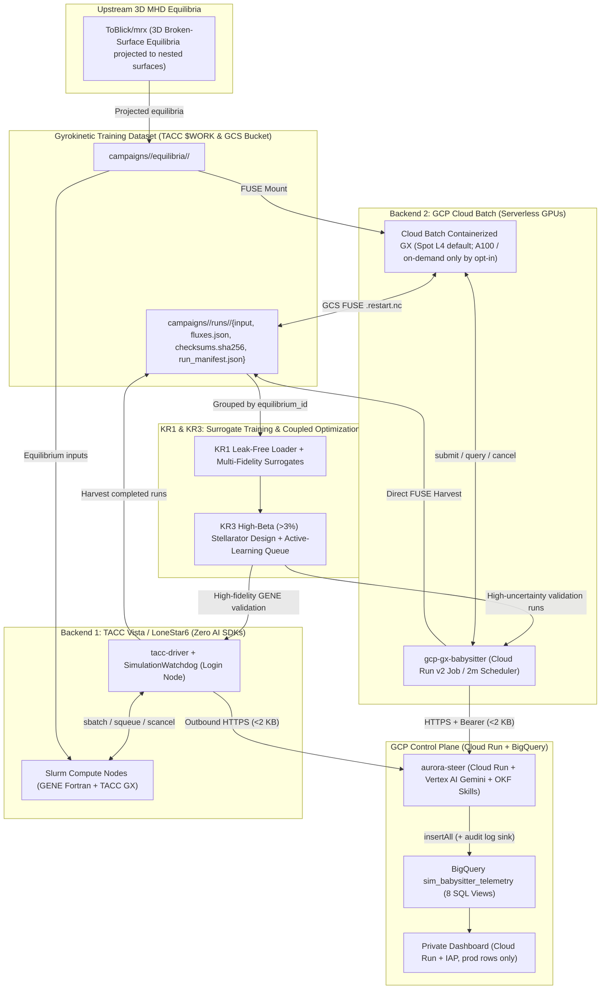
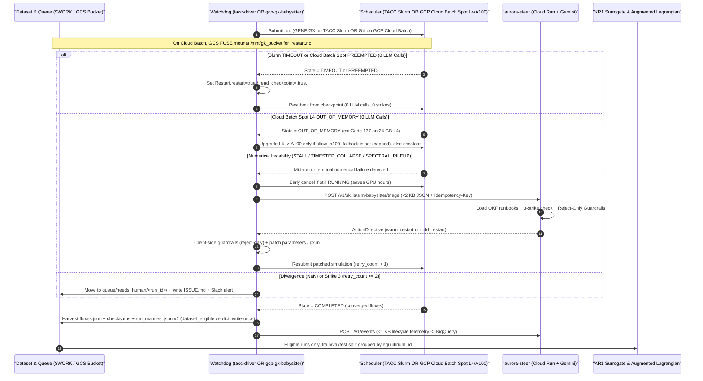

# System Architecture & Updated Sequence Diagrams (`docs/architecture.md`)

## 1. End-to-End Platform Architecture

---

## 2. Dual-Backend Babysitting Sequence Diagram (TACC Slurm **and** GCP Cloud Batch)

Yes — **automated babysitting works identically on both TACC Slurm and GCP Cloud Batch** via the shared `SchedulerBackend` protocol (`hpc_core/protocol.py`) and `SimulationWatchdog` (`tacc_exec/watchdog.py`):

---

## 3. Execution Environments Across TACC & GCP

| Layer | Where It Runs | Why |
| :--- | :--- | :--- |
| **GENE & TACC GX Simulation Campaigns** | **TACC Vista / LoneStar6 (`SlurmBackend`)** | Primary HPC allocation running multi-node GENE (Fortran) and GX simulations with a zero-AI login-node watchdog (`tacc-driver`). |
| **Cloud GX Simulation Campaigns** | **GCP Cloud Batch (`CloudBatchBackend`)** | Serverless GPU execution (**Spot L4** by default; Spot A100 and on-demand capacity only when the operator enables `allow_a100_fallback` / `allow_on_demand`), mounting the GCS dataset bucket via FUSE. |
| **`aurora-steer` + Telemetry Dashboard + `gcp-gx-babysitter`** | **GCP Cloud Run (Services & Job)** | Scale-to-zero HTTPS triage endpoint (single instance; `MODEL_ID`, default `gemini-4-argon`), BigQuery telemetry, private IAP dashboard, and 2-minute Cloud Scheduler watchdog ticks. |
