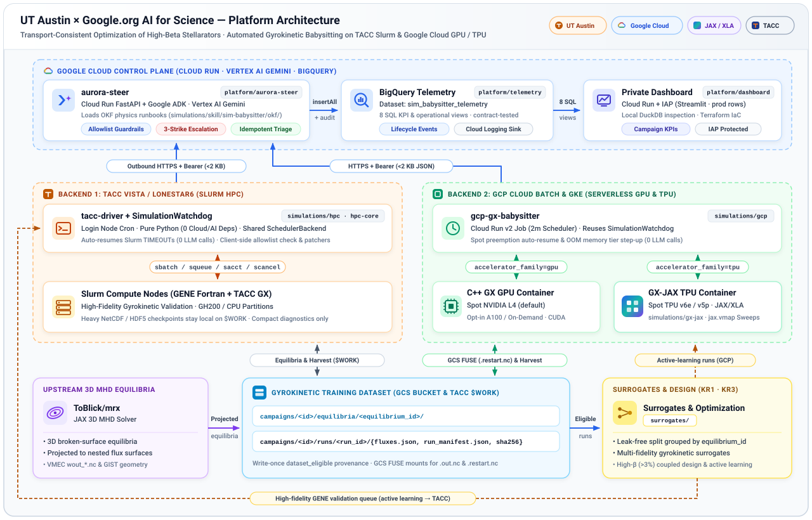
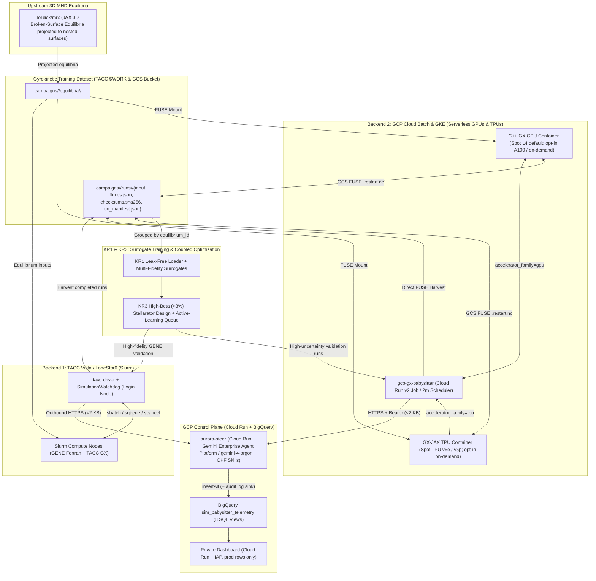
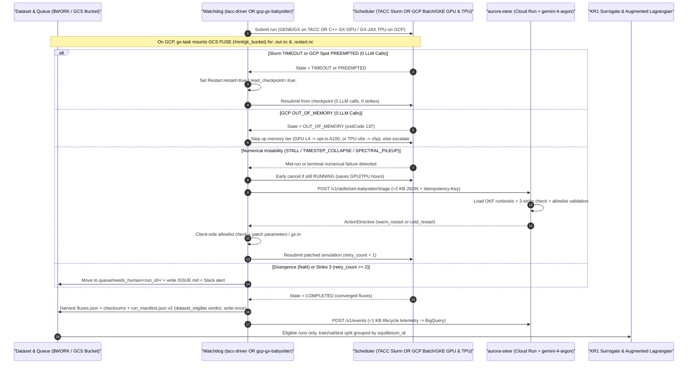

# System Architecture & Sequence Diagrams (`docs/architecture.md`)

## 1. End-to-End Platform Architecture

Mermaid flowchart view

---

## 2. Dual-Backend Babysitting Sequence Diagram (TACC Slurm **and** GCP GPU/TPU)

Automated babysitting works identically across **TACC Slurm** and **GCP Cloud Batch / GKE (GPU or TPU)** via the shared `SchedulerBackend` protocol (`hpc_core/protocol.py`), `SimulationWatchdog` (`tacc_exec/watchdog.py`), and the `gx-task` container wrapper (which invokes either C++ `gx` or the `gx-jax` CLI):

---

## 3. Execution Environments Across TACC & GCP

| Layer | Where It Runs | Why |
| :--- | :--- | :--- |
| **GENE & TACC GX Simulation Campaigns** | **TACC Vista / LoneStar6 (`SlurmBackend`)** | Primary HPC allocation running multi-node GENE (Fortran) and C++ GX simulations with a lightweight login-node watchdog (`tacc-driver`). |
| **Cloud GX GPU Campaigns** | **GCP Cloud Batch / GKE (`accelerator_family="gpu"`)** | Serverless C++ GX execution (**Spot L4** by default; Spot A100 and on-demand capacity only when enabled via `allow_a100_fallback` / `allow_on_demand`), mounting the GCS dataset bucket via FUSE. |
| **Cloud GX-JAX TPU Campaigns** | **GCP Cloud Batch / GKE (`accelerator_family="tpu"`)** | JAX/XLA port of the GX stellarator flux-tube core (`simulations/gx-jax`) running on **Spot TPU `v6e` / `v5p`** (Cloud Batch or GKE Compute Classes) through the same `gx-task` wrapper, `.in` decks, and `.out.nc` / `.restart.nc` schema. |
| **`aurora-steer` + Telemetry Dashboard + `gcp-gx-babysitter`** | **GCP Cloud Run (Services & Job)** | Scale-to-zero HTTPS triage endpoint (single instance; `MODEL_ID`, default `gemini-4-argon`), BigQuery telemetry, private IAP dashboard, and 2-minute Cloud Scheduler watchdog ticks. |
