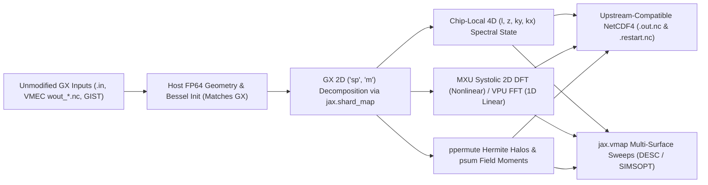

# GX-JAX Cloud TPU Benchmarks & Physics Parity

This note summarizes the verified physics parity, step-time performance, and runtime configuration of **`GX-JAX`** on Google Cloud TPU (`v5p` and `v6e` Trillium). `GX-JAX` is a pure Python + JAX/XLA translation of the MIT-licensed C++/CUDA **`GX`** gyrokinetic code (Mandell et al. 2024, *J. Plasma Phys.* **90**, 905900402, [arXiv:2209.06731](https://arxiv.org/abs/2209.06731)) built to read unmodified `.in` decks, VMEC `wout_*.nc` equilibria, and GIST geometry files and emit upstream-compatible NetCDF4 `.out.nc` and `.restart.nc` outputs.

## Translation Architecture

### Numerical Refinements Relative to Upstream C++ `float32`

Every place where `GX-JAX` improves numerical conditioning over upstream C++ `float32` is regression-tested in the test suite:

1. **Host `float64` polarization init:** Computes static `1 - sum_l J_l(b)^2` in host `float64` as `-expm1(-b) - sum_{l>=1} J_l(b)^2` to avoid `float32` subtraction loss on Kinetic Alfvén Waves ($b_e \sim 10^{-8}$).
2. **Increment-form SSP/RK stages:** Evaluates `sspx2`, `sspx3`, and `k10` stages in cancellation-free increment form (`g0 + delta`).
3. **Nonlinear `nonTwist` (`NTFT`) fixes:** Resolves three upstream C++ bugs in nonlinear `NTFT` mode (extra `/ ny` division in `nonlinear.cu`, `Nm = 1` CUDA grid extent leaving $m \ge 1$ zeroed, and in-place overwrite of `J0phi`/`J0apar` prior to `dyC2R`) so `nonTwist = true` at $\delta k_x = 0$ agrees with `nonTwist = false` to $< 10^{-13}$.

## Verified Physics Parity vs. Upstream `GX`, `stella`, and `GENE`

| Validation Suite | Configuration | `GX-JAX` on Cloud TPU (`fp32`) | Upstream `GX` / Published Reference | Outcome |
| :--- | :--- | :--- | :--- | :--- |
| **Linear Eigenmodes** *(ITG Adiab, ITG Kinetic, EM KBM)* | `v6e` (`1x4`, `2x2`) vs. upstream C++ `GX` `.out.nc` | **`23 / 27` modes pass strict `check.py`** (`14/15` adiab `< 3.74e-4`; kinetic `ky=0.2–0.6 < 6e-4`; KBM `< 1.08e-3`) | Upstream C++ `GX` GPU `.out.nc` golden traces | **Pass** *(all 4 outliers sit on marginally growing low-`ky` modes where upstream trace is unconverged)* |
| **Cross-Mesh & Backend Reproducibility** | `1`, `4`, `8` chips (`v6e`, `v5p`, `v5p-16`), `fft` vs. `mxu`, `Linked` & `NTFT` | Relative agreement **`~1e-6`** across all 72 TPU runs (`0.0` multi-host diff on 2-process loopback) | Single-chip / IEEE `fp32` roundoff floor | **Pass** *(zero multi-chip or multi-host numerical degradation)* |
| **Nonlinear Cyclone Base Case** *(Mandell et al. Table 1 / App. D.3)* | `192×64×24`, `(L,M)=(4,8)`, `t_max = 2000` (`74,218` steps on `4× v5p`) | **`Q_i / Q_GB = 6.91 ± 0.85`** (`SE = 0.06` over `t = 1000..2000`), **`8.49 min`** wall time (`1.97 min` on `4× v6e` at `t_max = 400`) | **`Q_i / Q_GB = 7.4 ± 0.9`**, **`9.0 min`** (`t_max = 2000`) / `< 5 min` (`t_max = 400`) on `1×` upstream `GX` GPU ([arXiv:2209.06731](https://arxiv.org/abs/2209.06731)) | **Validated** *(within `0.55σ` of upstream `GX`; `2.54×` faster wall time on `4× v6e` at `t_max = 400`)* |
| **Nonlinear 3D W7-X Stellarator** *(Bean Tube, `s = 0.64`, App. D.6)* | `64×192×128`, `(L,M)=(4,8)`, `t_max = 1400` (`50,393` steps on `4× v5p`) & `t_max = 200` (`4× v6e`) | **`Q_i / Q_GB = 2.13 ± 0.12`** in `stella`/`GENE` units (`6.01` `GX` units via $2\sqrt{2}$ $v_{\text{th}}$ factor) in **`17.82 min`**; `t_max = 200` in **`2.98 min`** (`4× v6e`) | **`2.26` (`stella`) – `2.47` (`GENE`)** over $t_{\text{stella}} \in [1500,1900]$ ([arXiv:2107.06060](https://arxiv.org/abs/2107.06060)); **`20 min`** upstream `GX` GPU at `t_max = 200` | **Validated** *(`5.9%` from `stella` over `7×` longer window in `< 18 min`; **`6.72×` faster** than upstream `GX` at `t_max = 200`)* |

## Step-Time & Throughput Comparison vs. Published Upstream `GX`

All upstream `GX` baselines come directly from **Tables 1 and 2 of Mandell et al. (2024, *J. Plasma Phys.* 90, 905900402, [arXiv:2209.06731](https://arxiv.org/abs/2209.06731))** (`NVIDIA A100` C++/CUDA `GX` `wallclock / steps`). Measured `GX-JAX` values report steady-state compiled kernel `ms/step` (`--fft-backend mxu`, `fp32`, excluding one-time XLA compilation):

| Upstream `GX` Benchmark Grid (`Nx × Ny × Nz`, `(L, M)`, Active Spectral DOFs) | Upstream `GX` Ref Chips | Upstream C++/CUDA `GX` (`ms/step`) | `GX-JAX` Equal-Chip `TPU v5p` (`ms/step`) | `GX-JAX` Scaled Slice (`v5p` / `v6e` `ms/step` & Peak `MDOF/s`) | Speedup vs. Upstream `GX` |
| :--- | :---: | :---: | :---: | :---: | :---: |
| **Table 1 Cyclone Adiab `(4, 8)`** (`192×64×24`, `2.15M` DOFs, `rk3`) | `1×` | `11.0 ms` | `1× v5p`: `13.21 ms` | **`4× v5p` (`1x4`): `6.37 ms`** (`337 MDOF/s`) | `0.83×` equal-chip (**`1.73×` on `4× v5p`**) |
| **Table 1 Cyclone Adiab `(8, 16)`** (`192×64×24`, `8.58M` DOFs, `rk3`) | `1×` | `37.0 ms` | **`1× v5p`: `34.77 ms`** | **`4× v5p` (`1x4`): `14.73 ms`** (`583 MDOF/s`) | **`1.06×` equal-chip** (**`2.51×` on `4× v5p`**) |
| **Table 1 Cyclone Adiab `(16, 32)`** (`192×64×24`, `34.3M` DOFs, `rk3`) | `1×` | `140.0 ms` | **`1× v5p`: `135.23 ms`** | **`4× v5p` (`1x4`): `37.67 ms`** (`911 MDOF/s`) | **`1.04×` equal-chip** (**`3.72×` on `4× v5p`**) |
| **Table 2 Cyclone Kinetic EM `(4, 16)`** (`192×64×32`, `11.4M` DOFs, `sspx3`, `β=10⁻³`) | `4×` | `22.0 ms` | **`4× v5p` (`2x2`): `22.12 ms`** | `4× v6e`: `~23.7 ms`¹ \| **`8× v6e` (`2x4`): `~13.3 ms`¹** (`517 MDOF/s` on `4× v5p`) | **`1.00×` equal-chip (`v5p`)** (**`1.65×` on `8× v6e`¹**) |
| **Table 2 Cyclone Kinetic EM `(8, 16)`** (`192×64×32`, `22.9M` DOFs, `sspx3`, `β=10⁻³`) | `4×` | `38.0 ms` | **`4× v5p` (`2x2`): `36.85 ms`** | `4× v6e`: `~47.1 ms`¹ \| **`8× v6e` (`2x4`): `~26.8 ms`¹** (`621 MDOF/s` on `4× v5p`) | **`1.03×` equal-chip (`v5p`)** (**`1.42×` on `8× v6e`¹**) |
| **Table 2 Cyclone Kinetic EM `(4, 32)`** (`192×64×32`, `22.9M` DOFs, `sspx3`, `β=10⁻³`) | `8×` | `29.0 ms` | **`8× v5p-16` (`2x4`, 2 hosts): `22.23 ms`** | Dedicated multi-host ICI (`1,030 MDOF/s`) | **`1.30×` faster** (`1.51×` `dt`-adj.)² |
| **Table 2 Cyclone Kinetic EM `(8, 32)`** (`192×64×32`, `45.8M` DOFs, `sspx3`, `β=10⁻³`) | `8×` | `45.0 ms` | **`8× v5p-16` (`2x4`, 2 hosts): `37.04 ms`** | Dedicated multi-host ICI (`1,236 MDOF/s`) | **`1.21×` faster** (`1.41×` `dt`-adj.)² |
| **Table 2 Cyclone Kinetic EM `(16, 32)`** (`192×64×32`, `91.6M` DOFs, `sspx3`, `β=10⁻³`) | `8×` | `86.0 ms` | **`8× v5p-16` (`2x4`, 2 hosts): `65.27 ms`** | Dedicated multi-host ICI (**`1,403 MDOF/s`**) | **`1.32×` faster** (`1.52×` `dt`-adj.)² |

¹ *`TPU v6e` `Nz = 32` values scaled `× 4/3` from measured `Nz = 24` runs (`17.79 ms` & `35.31 ms` on `4× v6e`; `9.96 ms` & `20.08 ms` on `8× v6e`); `× 4/3` linear-in-`Nz` scaling verified to `< 2%` on `TPU v5p` (`16.90 ms → 22.12 ms` and `27.63 ms → 36.85 ms`). Additionally, `4.29M`-DOF adiabatic Cyclone (`192×64×24, L=4, M=16`) runs in `7.22 ms` on `4× v6e` and `4.22 ms` on `8× v6e` (`2.61×` faster than `1×` upstream `GX` `11.0 ms`).*  
² *Upstream `GX`'s current linear CFL formula yields `dt ≈ 0.00058` on `M = 32` (vs. `Δt = 0.0005` reported in Table 2 of the paper), advancing `16%` more physical time per step (`1.41×–1.52×` effective physical-time speedup).*

## Validated Stellarator Workflows on Cloud TPU

1. **Electromagnetic 3D Stellarator Turbulence (`W7-X`, `12.39M` DOFs):** Verified on 2-species electromagnetic ($\beta = 10^{-3}$, `fphi = fapar = fbpar = 1`) 3D W7-X turbulence (`96×96×48`, `L=4, M=16`) in both Twist-and-Shift (`boundary = "fix aspect"` / `Linked`: **`19.42 ms/step`** on `8× v6e`, **`25.78 ms/step`** on `4× v5p`) and Non-Twisting Flux Tube (`nonTwist = true` / `NTFT`: **`47.05 ms/step`** on `4× v6e`, **`48.26 ms/step`** on `4× v5p`), with all 8 VMEC vs. GIST geometric/drift profiles correlating $\ge 0.9990$.
2. **Vectorized `jax.vmap` Multi-Surface Stellarator Sweeps:** Evaluates 4–8 W7-X radial flux surfaces (`s = 0.25, 0.49, 0.64, 0.81`, `t_max = 200`, `~34k` steps/surface) simultaneously inside one compiled XLA executable at **`3.63` (`4× v6e`) to `4.55` (`8× v6e`) full equilibria/min end-to-end** (`0.046 ms/eq-step` = `36.6` equilibria/min pure-kernel throughput).

## Runtime Configurability & Upstream Default Parameters

Every physics, geometry, dissipation, and time-integration parameter is runtime-configurable through standard upstream `GX` TOML `.in` decks or CLI overrides—no source edits required:

| Parameter Group | Upstream `GX` & `GX-JAX` Code Defaults (`parameters.cu` / `config.py`) | Values Used in Benchmark `.in` Decks | How to Change It (Zero Code Edits) |
| :--- | :--- | :--- | :--- |
| **`[Dimensions]`** *(Grid & Velocity)* | `ntheta = 32`, `nperiod = 1`, `nhermite = 4`, `nlaguerre = 2`, `nspecies = 1` (`nx`/`ny` or `nkx`/`nky` required; standard `2/3` dealiasing) | Cyclone: `192×64×24..32`, `(L,M) = (4,8)..(16,32)`, `nspecies = 1..2` W7-X NL: `64×192×128` `(4,8)` & `96×96×48` `(4,16)` | Edit `[Dimensions]` in `<deck>.in` *(structural shape change triggers a one-time `~5–15 s` XLA compile at run start)*. |
| **`[Domain]`** *(Flux Tube & Boundary)* | `boundary = "linked"`, `nonTwist = false`, `y0 = 10.0`, `x0 = -1.0` *(auto-set from `jtwist` & `shat`)*, `zp = 2*nperiod - 1`, `long_wavelength_GK = false` | `boundary = "linked"` (`y0 = 30.0` Cyclone; `y0 = 21.0` W7-X) or `"fix aspect"` / `nonTwist = true` (`NTFT` W7-X) | Set `boundary = "linked"`, `"fix aspect"`, `"periodic"`, `"exact periodic"`, `"continuous drifts"`, or `nonTwist = true` in `[Domain]`. |
| **`[Geometry]`** *(Equilibrium)* | `geo_option = "s-alpha"`, `torflux = 0.64`, `npol = 1.0`, `alpha = 0.0`, `Rmaj = 1.0`, `qinp = 1.4`, `shat = 0.8`, `rhoc = 0.5` | Cyclone: `geo_option = "miller"` (`Rmaj = 2.77778, qinp = 1.4, shat = 0.8`) W7-X: `geo_option = "vmec"`, `vmec_file = "wout_w7x.nc"`, `s = 0.64` (`0.25..0.81` in `vmap`) | Point `vmec_file` to any VMEC `wout_*.nc` (e.g., high-$\beta$ W7-X, HSX, or `DESC`-exported equilibria) and set `desired_normalized_toroidal_flux` (`torflux`), `alpha`, `npol`. |
| **`[Physics]` & `[Boltzmann]`** | `nonlinear_mode = false`, `beta = 0.0`, `fphi = 1.0`, `fapar = fbpar = 1.0` *(if `beta > 0` else `0.0`)*, `ei_colls = true`, `coll_conservation = true`, `g_exb = 0.0`, `add_Boltzmann_species = false` (`tau_fac = 1.0`) | Adiabatic T1 / W7-X: `beta = 0.0`, `add_Boltzmann_species = true` (`electrons`) Kinetic T2 / W7-X EM: `beta = 1e-3`, `fphi = fapar = fbpar = 1.0`, `ei_colls = false` | Edit `[Physics]` / `[Boltzmann]` in `<deck>.in` (e.g., sweep finite `beta = 0.02..0.08` for high-$\beta$ stellarator studies) or pass `--nonlinear` / `--linear` on CLI. |
| **`[species]`** *(Profiles & Collisions)* | Per-species arrays `z`, `mass`, `dens`, `temp = 1.0`, `tprim = 0.0`, `fprim = 0.0`, `vnewk = 0.0`, `type = "ion" \| "electron"` | Cyclone: `tprim = 2.49, fprim = 0.8`, `mass_e = 2.7e-4`, `vnewk = [1.67e-4, 0.01]` W7-X: `tprim = 3.0, fprim = 1.0` | Edit `[species]` arrays in `<deck>.in` for arbitrary ion/impurity/electron mixtures, temperature/density gradients, and collisionalities. |
| **`[Time]`** *(Stepper & Horizon)* | `scheme = "rk3"`, `cfl = 0.9`, `dt = 0.05` *(adaptive CFL max unless `fixed_dt = true`)*, `dt_min = 1e-7`, `t_max = 1e20`, `nstep = 2e9` | T1 / W7-X: `scheme = "rk3"`, `cfl = 0.9–1.0`, `t_max = 200..2000` T2 Kinetic EM: `scheme = "sspx3"`, `cfl = 1.0` | Set in `[Time]` or override dynamically via CLI: `--scheme {sspx2,rk3,sspx3,rk4,k10}`, `--t-max`, `--nstep`, `--dt`. |
| **`[Dissipation]`** *(Closures & Hyper)* | `closure_model = "none"`, `hypercollisions = false` *(default `nu_hyper_m = 1.0`, `p_hyper_m = min(20, M//2)`, `nu_hyper_l = 0.0`, `p_hyper_l = 6`)*, `hyper = false` (`D_hyper = 0.1, p_hyper = 2`), `hyperz = false` | App. D.3 / D.6 & Table 2: `hypercollisions = true`, `nu_hyper_m = nu_hyper_l = 0.1`, `p_hyper_m = p_hyper_l = 6`, `hyper = true`, `D_hyper = 0.05`, `p_hyper = 2` | Edit `[Dissipation]` in `<deck>.in` (supports `"none"`, `"beer4+2"`, `"smith_par"`, `"smith_perp"`, `HB_hyper`, `hyperz`, `damp_ends_*`). |
| **`[Diagnostics]`, `[Restart]` & TPU CLI** | `nwrite = 1000`, `navg = 10`, `free_energy = true`, `fluxes = false`, `fields = false`, `moments = false`, `save_for_restart = true`, `nsave = 10000`; CLI: `--precision fp32`, `--fft-backend auto`, `--async-io` | Benchmarks enabled `fluxes = true`, `nwrite = 100–200`, `--mesh 1x1 \| 1x4 \| 2x2 \| 2x4`, `--fft-backend mxu` (NL) or `fft` (1D linear) | Set in `[Diagnostics]` / `[Restart]` or override via CLI (`--nwrite`, `--write-fields`, `--write-moments`, `--restart-file`, `--precision fp64`, `--mesh SPxM`). |

**Zero-recompile parameter sweeps (`gx-jax-ensemble` / `jax.vmap`):** Continuous scalar and profile parameters (`beta`, `torflux` / radial surface `s`, `shat`, `kxfac`, `gradpar`, `tprim`, `fprim`, `dt`, `cfl`, `t_max`) are passed into XLA as traced array leaves rather than compile-time constants, so sweeping multiple equilibria or $\beta$ values in parallel across TPU chips requires zero XLA recompilation.
